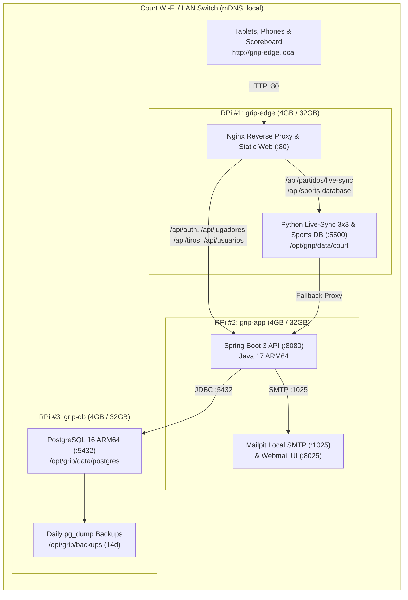
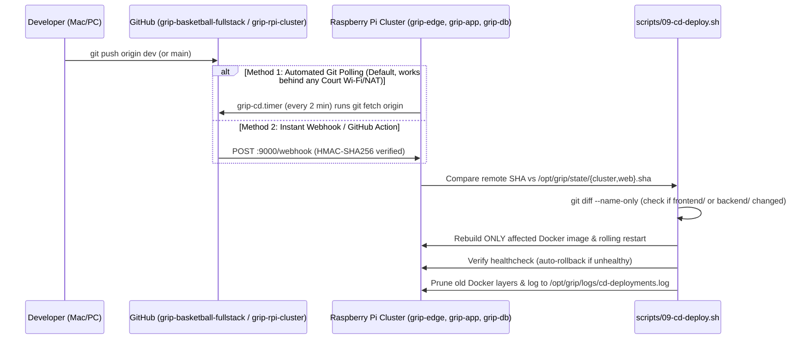

# Thorough Deployment, Plug-and-Play Startup & Continuous Deployment (CD) Guide — GRIP Raspberry Pi 4B Cluster

---

## 1. Architecture & Hardware Allocation (Why 3 of Your 5 Raspberry Pis)

Each of your 5 units is a **Raspberry Pi 4 Model B with 4 GB RAM and a 32 GB microSD card**.
Running all 5 simultaneously is **not necessary** and would increase power draw, network switch complexity, and SD card maintenance without adding value. Instead, we use **3 Raspberry Pis** in a clean 3-tier architecture and keep **2 Raspberry Pis unused as spares**:



### Why this 3-Node split is ideal for 4GB RAM / 32GB microSD:
1. **RPi #1 (`grip-edge.local`) — Edge Web & Real-Time Court Sync (`--role edge`)**
   * Runs `grip-frontend` (Nginx Alpine) and `grip-livesync` (`scripts/dev-server.py` on Python 3.11 Alpine).
   * Uses only **~350 MB of RAM**, ensuring zero lag for the 12-second 3x3 shot clock (`/api/partidos/live-sync`) and interactive shot charts (`/api/sports-database`).
2. **RPi #2 (`grip-app.local`) — Backend API & Local Mail Server (`--role app`)**
   * Runs `grip-backend` (Spring Boot 3 + Java 17 ARM64) and `grip-mailpit`.
   * During Continuous Deployment (CD), Maven compiles the Java backend inside Docker, temporarily using **~1.8–2.2 GB RAM**. Isolating `grip-app` on RPi #2 guarantees Maven builds never slow down the live scoreboard on RPi #1 or PostgreSQL on RPi #3.
3. **RPi #3 (`grip-db.local`) — Dedicated Database & Backup Vault (`--role db`)**
   * Runs `grip-db` (PostgreSQL 16 Alpine ARM64) tuned via `config/postgresql.rpi4.conf` (`shared_buffers = 512MB`, `effective_cache_size = 1536MB`, spaced WAL checkpoints to protect the 32GB microSD card).
   * Runs `grip-backup.timer` daily at 03:00 AM (and 15 minutes after boot), storing compressed `.sql.gz` dumps in `/opt/grip/backups` and automatically pruning backups older than 14 days.
4. **RPi #4 & RPi #5 — Unused / Spares (plus Optional Modes)**
   * **Keep RPi #4 and RPi #5 powered off as spares**, OR:
   * **Optional HDMI Scoreboard Kiosk (`--role kiosk`):** Connect RPi #4 via HDMI to a court TV/monitor; on power-on it boots straight into fullscreen Chromium showing `http://grip-edge.local/live-tracker.html`.
   * **Optional 1-Pi Portable Mode (`--role all-in-one`):** If traveling to an exhibition game where you only want to plug in **1 single Raspberry Pi**, `--role all-in-one` runs all containers on 1 RPi 4B.

---

## 2. Repository & Submodule Setup (Pushing to GitHub)

This project (`grip-rpi-cluster`) is already initialized as a Git repository with `https://github.com/Victor151203/grip-basketball-fullstack.git` registered in `.gitmodules` under `submodules/grip-basketball-fullstack`.

### Step 2.1 — Move (if desired) and push the new repo to GitHub
1. Create a new empty repository on GitHub named **`grip-rpi-cluster`** (e.g., `https://github.com/nicoparada35/grip-rpi-cluster.git`).
2. If you want the repo folder as a sibling directory in `/Users/nico/Documents/GitHub/grip-rpi-cluster`, move it and push:
   ```bash
   # Optional: move out of the workspace parent directory into /Users/nico/Documents/GitHub/
   mv /Users/nico/Documents/GitHub/grip-basketball-fullstack/grip-rpi-cluster /Users/nico/Documents/GitHub/grip-rpi-cluster
   cd /Users/nico/Documents/GitHub/grip-rpi-cluster

   # Link to your new GitHub remote and push
   git remote add origin https://github.com/nicoparada35/grip-rpi-cluster.git
   git branch -M main
   git push -u origin main
   ```
3. Also push the latest RPi gateway commit in your web repository (`grip-basketball-fullstack`):
   ```bash
   cd /Users/nico/Documents/GitHub/grip-basketball-fullstack
   git add scripts/dev-server.py frontend/nginx.conf docker-compose.rpi.yml .gitignore
   git commit -m "feat(rpi): configurable backend/data env vars in dev-server.py and live-sync nginx routing"
   git push origin dev
   ```

---

## 3. Preparing the 32GB microSD Cards on the 3 Raspberry Pis

For each of the **3 Raspberry Pi 4B (4GB)** units:

1. Insert the **32 GB microSD card** into your Mac and open **Raspberry Pi Imager**.
2. Select:
   * **Device:** `Raspberry Pi 4`
   * **OS:** `Raspberry Pi OS (other)` → **`Raspberry Pi OS Lite (64-bit)`** (Debian Bookworm ARM64 — *Lite* has no desktop bloat, saving ~400 MB RAM and ~4 GB of your 32 GB microSD; only use Desktop OS if setting up an optional `--role kiosk` HDMI node).
   * **Storage:** Your 32 GB microSD card.
3. Click **Edit Settings (OS Customisation)**:
   * **Hostname:**
     * Card 1: `grip-edge`
     * Card 2: `grip-app`
     * Card 3: `grip-db`
   * **Username & Password:** User `pi` (or your preferred admin user) and a strong password.
   * **Wireless LAN / Network:** Configure your court/router Wi-Fi SSID & password (or plug all 3 into a small 5-port Gigabit Ethernet switch connected to your Wi-Fi router — **Ethernet is strongly recommended** for zero packet loss).
   * **Services Tab:** Enable **SSH** (use password or public-key authentication).
4. Flash all 3 cards, insert them into RPi #1, RPi #2, and RPi #3, and power them on.

---

## 4. Installing the Complete Code & Services onto Each Raspberry Pi

You have **two ways** to install everything:

### Option A: One-Command Fleet Deployment from Your Mac (`deploy-fleet-ssh.sh`)
From your Mac terminal inside `grip-rpi-cluster`, run:
```bash
bash scripts/deploy-fleet-ssh.sh pi grip-db.local grip-app.local grip-edge.local
```
*(Or pass their LAN IP addresses if mDNS isn't active on your Mac yet, e.g. `bash scripts/deploy-fleet-ssh.sh pi 192.168.1.103 192.168.1.102 192.168.1.101`).*

This script automatically:
1. Syncs the entire `grip-rpi-cluster` repo + `grip-basketball-fullstack` submodule to each Pi.
2. Provisions **RPi #3 (`db`)** first and waits until PostgreSQL 16 is healthy.
3. Provisions **RPi #2 (`app`)** second, compiles the Spring Boot ARM64 container, and connects it to `grip-db.local:5432`.
4. Provisions **RPi #1 (`edge`)** third, starts `grip-livesync` + `grip-frontend` (Nginx), and links `/api/` to `grip-app.local:8080`.

---

### Option B: Cloning & Running Directly on Each Raspberry Pi
SSH into each Raspberry Pi and clone the repository with `--recurse-submodules`:

#### 1. On RPi #3 — Database Node (`grip-db`)
```bash
ssh pi@grip-db.local
git clone --recurse-submodules https://github.com/nicoparada35/grip-rpi-cluster.git ~/grip-rpi-cluster
cd ~/grip-rpi-cluster
sudo bash scripts/install-node.sh --role db
```

#### 2. On RPi #2 — Backend Application Node (`grip-app`)
```bash
ssh pi@grip-app.local
git clone --recurse-submodules https://github.com/nicoparada35/grip-rpi-cluster.git ~/grip-rpi-cluster
cd ~/grip-rpi-cluster
sudo bash scripts/install-node.sh --role app
```

#### 3. On RPi #1 — Edge Web & Live-Sync Node (`grip-edge`)
```bash
ssh pi@grip-edge.local
git clone --recurse-submodules https://github.com/nicoparada35/grip-rpi-cluster.git ~/grip-rpi-cluster
cd ~/grip-rpi-cluster
sudo bash scripts/install-node.sh --role edge
```

---

## 5. Directory Hierarchy Created on Every Raspberry Pi

When `install-node.sh` (via `00-common.sh` and `02-install-code.sh`) runs on a Raspberry Pi, it creates a standardized, self-contained directory tree under `/opt/grip`:

| Directory / File | Purpose |
| :--- | :--- |
| `/opt/grip/repo/` | Working copy of `grip-rpi-cluster` and `submodules/grip-basketball-fullstack`. |
| `/opt/grip/config/cluster.env` | Node-specific environment file (`GRIP_NODE_ROLE`, hostnames, DB/JWT secrets, CD branch). |
| `/opt/grip/config/nginx.rendered.conf` | Auto-rendered Nginx config on `grip-edge` with the active `GRIP_APP_HOST`. |
| `/opt/grip/data/postgres/` | Persistent PostgreSQL 16 data directory on `grip-db` (`chmod 700`). |
| `/opt/grip/data/court/` | Persistent JSON database (`sports-database.json`, `player-photos.json`, `team.json`, `site-config.json`) on `grip-edge`. |
| `/opt/grip/backups/` | Daily compressed PostgreSQL (`gripdb_*.sql.gz`) & Court JSON (`courtdata_*.tar.gz`) backups (auto-pruned after 14 days). |
| `/opt/grip/logs/` | Continuous Deployment (`cd-deployments.log`, `cd-service.log`), Webhook (`webhook.log`), and Backup (`backup.log`) logs. |
| `/opt/grip/state/` | Stores currently deployed Git commit SHAs (`cluster.sha` and `web.sha`) for CD diffing and rollback. |

---

## 6. How Boot Startup & Court Repositioning Work (Turn Off → Move → Turn On)

A common failure point with multi-Raspberry-Pi clusters when you unplug them, move them to a basketball court, and plug them back in is **boot race conditions** (e.g., the Wi-Fi router takes 30 seconds to boot, or RPi #1 finishes booting 15 seconds before RPi #3's database is ready).

Our scripts (`08-enable-startup.sh` and `grip-boot-guard.sh`) solve this using **4 layers of protection**:

1. **Zero-Config mDNS Discovery (`avahi-daemon`)**:
   * `01-provision-os.sh` installs `avahi-daemon` and `libnss-mdns` bound to both `eth0` and `wlan0`.
   * Even if a new court router assigns completely different DHCP IP addresses (e.g., `192.168.0.x` instead of `192.168.1.x`), `grip-db.local`, `grip-app.local`, and `grip-edge.local` resolve automatically without editing any IP configuration!
2. **Docker `restart: always` + Live Restore**:
   * `/etc/docker/daemon.json` is configured with `"live-restore": true`, and every service in `docker-compose.*.yml` uses `restart: always`.
3. **Systemd Boot Service (`grip-node.service`)**:
   * Registered at `/etc/systemd/system/grip-node.service` with `After=network-online.target docker.service avahi-daemon.service`.
   * Executes `/opt/grip/repo/scripts/grip-boot-guard.sh --start`, which waits up to 120 seconds for upstream TCP ports (`grip-db.local:5432` before `grip-app`, and `grip-app.local:8080` before `grip-edge`) before completing startup.
4. **2-Minute Self-Healing Watchdog (`grip-watchdog.timer`)**:
   * Runs `grip-boot-guard.sh --watchdog` every 2 minutes after boot.
   * If a Raspberry Pi was powered on before the court router or before another Pi, the watchdog detects any unreachable container or port (`:5432`, `:8080`, `:5500`, `:80`) and automatically heals/restarts the stack.

### Useful Commands to Inspect Startup Services on Any RPi:
```bash
# Check boot service status
sudo systemctl status grip-node.service

# Check active timers (Watchdog, Continuous Deployment, Backups)
sudo systemctl list-timers 'grip-*'

# View running Docker containers and health status
docker ps
```

---

## 7. How Continuous Deployment (CD) Works & How to Use It

Whenever you push changes to **`grip-basketball-fullstack`** (the web/backend submodule) or **`grip-rpi-cluster`** (the deployment repo), the Raspberry Pis automatically detect, pull, rebuild, and restart only the modified services.

We implemented **two complementary CD mechanisms** out of the box (both enabled automatically by `08-enable-startup.sh`):



### Method 1: Zero-Configuration Git Polling (`grip-cd.timer` — Active by Default)
Because Raspberry Pis on a basketball court LAN or cellular hotspot are usually behind NAT/firewalls (where GitHub cloud servers cannot open inbound ports directly), **Git Polling is the most reliable CD method**:
* Every **2 minutes**, `grip-cd.timer` triggers `grip-cd.service` → `/opt/grip/repo/scripts/09-cd-deploy.sh`.
* **Automatic Submodule Tracking (`GRIP_CD_TRACK_SUBMODULE_LATEST=true`):**
  * By default in `/opt/grip/config/cluster.env`, `GRIP_CD_TRACK_SUBMODULE_LATEST=true` is enabled.
  * This means **you do NOT even need to manually update the submodule commit pointer in `grip-rpi-cluster` every time you edit the website!**
  * As soon as you push a commit to the `dev` branch of `grip-basketball-fullstack`, within 2 minutes:
    * **RPi #1 (`grip-edge`)** checks `git diff --name-only`. If `frontend/` or `scripts/` changed, it rebuilds `grip-frontend` / `grip-livesync` in ~5 seconds. If only `backend/` changed, RPi #1 skips rebuilding!
    * **RPi #2 (`grip-app`)** checks `git diff --name-only`. If `backend/` changed, it runs the Maven multi-stage Docker build and restarts `grip-backend`. If only HTML/CSS/JS in `frontend/` changed, RPi #2 skips the heavy Maven build!
* **Automatic Rollback:** If a broken commit causes the container build or TCP healthcheck to fail, `09-cd-deploy.sh` catches the error (`trap rollback ERR`), resets Git to the previous working commit SHA stored in `/opt/grip/state/`, and restores the service.

### Method 2: Instant Push Webhook (`grip-cd-webhook.service` on Port `9000`)
Each Raspberry Pi also runs `cd/webhook-server.py` on port `9000` (managed by `grip-cd-webhook.service`).
* If your router forwards port `9000` (or you use Cloudflare Tunnel / Tailscale Funnel), add a Webhook in GitHub (**Settings → Webhooks → Add webhook**):
  * **Payload URL:** `http://<your-public-ip-or-tunnel>:9000/webhook`
  * **Content type:** `application/json`
  * **Secret:** Value of `GRIP_WEBHOOK_SECRET` in `/opt/grip/config/cluster.env` (default: `GripWebhookSecret2026!`)
* Or trigger an immediate CD deployment manually on the LAN from your Mac:
  ```bash
  # Trigger immediate CD pull & deploy on all 3 Pis via SSH:
  for host in grip-db.local grip-app.local grip-edge.local; do
    ssh pi@$host "sudo bash /opt/grip/repo/scripts/09-cd-deploy.sh --force"
  done
  ```

### Viewing CD Deployment Logs on Any Raspberry Pi:
```bash
# View audit history of every automated deployment
cat /opt/grip/logs/cd-deployments.log

# Follow live CD output during a build
tail -f /opt/grip/logs/cd-service.log
```

---

## 8. End-to-End Verification Checklist

Once your 3 Raspberry Pis are running, verify the entire cluster from any laptop, tablet, or phone on the same Wi-Fi/LAN:

1. **Edge Healthcheck:**
   ```bash
   curl http://grip-edge.local/healthz
   # Expected: {"status":"ok","node":"grip-edge"}
   ```
2. **Real-Time 3x3 Live-Sync API:**
   ```bash
   curl http://grip-edge.local/api/partidos/live-sync
   # Expected: {"version":1,"scoreHome":0,"scoreAway":0,"gameSeconds":600,"shotSeconds":12.0,...}
   ```
3. **Spring Boot Backend API (Proxied through RPi #1 → RPi #2 → RPi #3):**
   ```bash
   curl http://grip-edge.local/api/jugadores
   ```
4. **Web Portal & Live-Tracker UI:**
   * Landing & Analytics: `http://grip-edge.local/`
   * Live 3x3 Court Scoreboard & Shot Tracker: `http://grip-edge.local/live-tracker.html`
   * Player Analytics Dashboard: `http://grip-edge.local/players.html`
   * Admin Panel: `http://grip-edge.local/admin.html` (`admin@gripbasketball.com` / `GripAdmin2026!`)
   * Local Mailpit Webmail (for viewing confirmation emails offline): `http://grip-app.local:8025`
